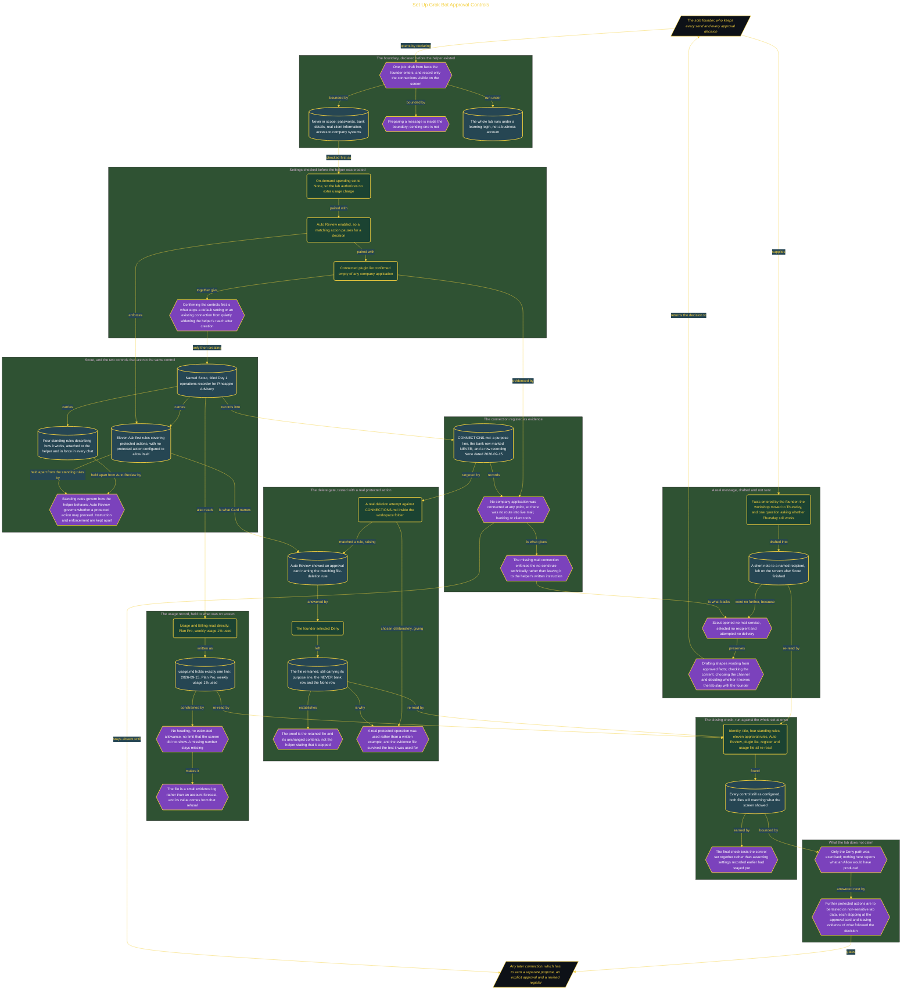

# Set Up Grok Bot Approval Controls

> Inside the [Solo Startup Systems Engineering](../../README.md) portfolio · *Systems for building and scaling a startup as a solo operator.*

## Overview

I created one Grok Bot helper named Scout for a controlled Day 1 operations lab. Scout could draft content from facts I entered and record only the connections visible on the screen. It could not receive passwords, bank details, real client information, or access to company systems. The work remained under my learning login.

The boundary also kept all external actions under human control. Scout could prepare a message, but it could not send one from this lab. No company app was connected, and the bank connection remained prohibited. This allowed me to test instructions, approval gates, files, and drafting behavior without creating a path into live email, banking, or client tools.

The architecture is built across **7 phases**, anchored by **Establishing a Safe AI Operations Boundary** on the input side and **Documenting the Intact Connection Boundary** at the end. Each phase is listed in the Implementation section below.

## Architecture

The diagram shows the topology and data flow of the system as built. The full architectural narrative, with screenshots and prose, lives in [`documents/grok-bot-approval-controls.md`](./documents/grok-bot-approval-controls.md).

## Implementation

This system is built across **7 phases**:

1. **Establishing a Safe AI Operations Boundary**
2. **Preparing Grok Bot for Controlled Work**
3. **Building Scout's Day 1 Control Set**
4. **Proving the Delete Gate and Recording Usage**
5. **Drafting a Real Message While Keeping Sending Human-Controlled**
6. **Verifying the Complete Day 1 Control Set**
7. **Documenting the Intact Connection Boundary**

For the full walkthrough with screenshots and step-by-step content, see [`documents/grok-bot-approval-controls.md`](./documents/grok-bot-approval-controls.md).

## Validation

Each build phase below is documented in [`documents/grok-bot-approval-controls.md`](./documents/grok-bot-approval-controls.md), with screenshots, configuration, and notes as captured during the build:

- ✅ Establishing a Safe AI Operations Boundary
- ✅ Preparing Grok Bot for Controlled Work
- ✅ Building Scout's Day 1 Control Set
- ✅ Proving the Delete Gate and Recording Usage
- ✅ Drafting a Real Message While Keeping Sending Human-Controlled
- ✅ Verifying the Complete Day 1 Control Set
- ✅ Documenting the Intact Connection Boundary
