# The Calendar Door That Stayed Closed

> Inside the [Solo Startup Systems Engineering](../../README.md) portfolio · *Systems for building and scaling a startup as a solo operator.*

## Overview

I designed a controlled path for preparing one 30-minute Clarity call with Grok Bot and Google Calendar. The intended operating model kept Google Workspace settings under my control. Scout would receive access only after I proved that Calendar was unavailable without a plugin and documented the connection change in the register.

This remained a learning lab rather than a live company deployment. I did not send a booking note, create a real Calendar event, open the company admin console, or complete a Calendar provider sign-in. The exercise tested the control sequence around a realistic booking while keeping the live account unchanged. Founder approval remained the boundary between Scout's drafting role and any external account action.

The architecture is built across **6 phases**, anchored by **Defining a Safe, Founder-Controlled Booking Goal** on the input side and **Auditing the Operating Record Against Live Systems** at the end. Each phase is listed in the Implementation section below.

## Architecture

```mermaid
---
title: The Calendar Door That Stayed Closed
---
%%{init: {"theme":"base","themeVariables": {"primaryColor":"#1B4332","primaryTextColor":"#F4D03F","primaryBorderColor":"#F4D03F","secondaryColor":"#264653","tertiaryColor":"#2F5233","lineColor":"#F4D03F","fontFamily":"ui-monospace, SFMono-Regular, Menlo, Consolas, monospace","fontSize":"13px"}}}%%
flowchart TD
    classDef datastore fill:#264653,stroke:#F4D03F,stroke-width:2px,color:#FFFFFF
    classDef service fill:#1B4332,stroke:#F4D03F,stroke-width:2px,color:#F4D03F
    classDef event fill:#7B42BC,stroke:#F4D03F,stroke-width:2px,color:#FFFFFF
    classDef io fill:#0d1117,stroke:#F4D03F,stroke-width:1.5px,color:#F4D03F,font-style:italic

    Founder[/The founder, who keeps provider sign-in, plugin approval and sending/]
    Owed[/The read-only Calendar test that is owed, needing an authorized plugin, a register entry and evidence of a read that creates nothing/]

    subgraph Intent["The goal, and the line under it"]
        Goal{{Prepare one 30-minute Clarity call, with Google Workspace settings staying under founder control}}
        Order{{Scout receives access only after Calendar is proven unavailable without a plugin and the change is written into the register}}
        NotDone[("Deliberately not done: no booking note sent, no real Calendar event, no admin console opened, no provider sign-in completed")]
        Lab{{A learning lab, not a live company deployment. The live account ends the run unchanged}}
    end

    subgraph Controls["Account controls, read before any Calendar work"]
        Meter(Weekly usage read at 1 percent with on-demand usage off)
        Gates(Auto Review Ask first gates left enabled)
        Scoped[(Scout's saved rules confine it to research and writing inside the pineapple workspace)]
        Forbidden[(Those rules prohibit sign-in, sending and settings changes)]
        Separation{{Assistance is separated from authority: Scout may draft, but it may not spend, reconfigure, delete evidence or contact a person}}
    end

    subgraph Register["The register, as a clean baseline"]
        Cols[("A six-column register opening with one row: no application connected")]
        Empty{{It carries no account address, credential or secret, so the baseline itself discloses nothing}}
        Visible{{A later connection would add a row making the purpose, scope and review state visible, rather than living only inside the bot interface}}
    end

    subgraph Draft["A checklist written before access existed"]
        Stop(A planned three-line review stop: Recovery, Two-step verification, Shared drive)
        Edition[(The Shared drive line also says to check the account edition, since the control depends on the Workspace setup)]
        Approve(The founder read the three lines, then typed continue as explicit authorization)
        Rest[("Scout then completed all seven undated setting lines and added empty headings for later evidence")]
        NoLinks{{The file carried no web address, and Scout opened no page, signed in nowhere and read no Calendar}}
        Sample{{Approving a small sample first kept a flawed format from spreading through the whole checklist}}
        Planning{{Approving the draft is not approving account access. The checklist stays a planning artifact until the founder performs each review}}
    end

    subgraph Dated["Dating the lines, and what that did not mean"]
        Done[("Seven lines dated Done by me on 2026-09-15, inside the learning record")]
        Exercise{{These represent the lab exercise rather than verified changes to a live company account}}
        NoDoor[(No live settings page was opened and no provider sign-in completed, so no Calendar door was opened during this run)]
    end

    subgraph Closed["The closed-door test, run as the negative control"]
        Ask(Scout asked to perform a Calendar read before any plugin existed)
        Refuse[("Scout stated it had no Calendar connection and would not sign in")]
        Nothing[(No event title returned, no provider authorization flow opened, the register left unchanged)]
        Why{{A checklist describing a future connection does not grant one, and proving that first is what makes a later successful read attributable to the documented change rather than to access that was always there}}
    end

    subgraph Booking["A real scenario, stopped before the provider"]
        Clarity(A realistic 30-minute Clarity call used as the booking scenario)
        Line[("The First booking line states plainly that there was no live booking")]
        Unsent[(The draft note stayed unsent, and no live Calendar event was created)]
        Narrow{{The measured result is narrower than the goal: Scout respected a closed boundary and wrote nothing. It is not proof of a successful read-only read}}
    end

    subgraph Audit["The closing audit, against what the screen showed"]
        Compare(The visible usage meter compared with usage.md, the Proof section, the register and the First booking line)
        Matched[("Meter 2026-09-15 at 1% used, matching the observed percentage with no allowance invented")]
        Held[(The Proof section still held the pre-plugin refusal, the register still showed no application connected, and no Calendar event existed)]
        Aligned{{One matched reading, one closed-door result, no plugin, no live booking, and no claim that Calendar was accessed}}
    end

    subgraph Language["The hardest part was the wording"]
        Tension[(The title and the checklist describe a Calendar connection that the run intentionally stopped short of)]
        Distinguish{{The evidence had to separate planned access from granted access, so a refusal test is never written up as a working integration}}
    end

    Founder -- "sets" --> Goal
    Goal -- "sequenced by" --> Order
    Goal -- "bounded by" --> NotDone
    Goal -- "framed as" --> Lab
    Order -- "begins with reading" --> Meter
    Meter -- "paired with" --> Gates
    Gates -- "narrowed further by" --> Scoped
    Scoped -- "which prohibit" --> Forbidden
    Forbidden -- "together give" --> Separation
    Scoped -- "baselined in" --> Cols
    Cols -- "deliberately holds nothing in" --> Empty
    Cols -- "designed so that" --> Visible
    Separation -- "permits only" --> Stop
    Stop -- "includes" --> Edition
    Stop -- "paused for" --> Approve
    Approve -- "released" --> Rest
    Rest -- "written under" --> NoLinks
    Approve -- "is why" --> Sample
    Rest -- "held under" --> Planning
    Rest -- "then dated as" --> Done
    Done -- "qualified by" --> Exercise
    Exercise -- "which is why" --> NoDoor
    NoDoor -- "set up" --> Ask
    Ask -- "answered by" --> Refuse
    Refuse -- "left" --> Nothing
    Cols -- "unchanged by" --> Nothing
    Nothing -- "establishes" --> Why
    Why -- "makes room for" --> Clarity
    Clarity -- "recorded as" --> Line
    Line -- "accompanied by" --> Unsent
    Unsent -- "bounded by" --> Narrow
    Meter -- "re-read by" --> Compare
    Line -- "re-read by" --> Compare
    Refuse -- "re-read by" --> Compare
    Compare -- "found" --> Matched
    Compare -- "found" --> Held
    Matched -- "together give" --> Aligned
    Held -- "together give" --> Aligned
    Aligned -- "reported to" --> Founder
    NotDone -- "creates" --> Tension
    Tension -- "resolved by" --> Distinguish
    Narrow -- "is the product of" --> Distinguish
    Distinguish -- "leaves" --> Owed
    Visible -- "is the precondition for" --> Owed

    class NotDone,Scoped,Forbidden,Cols,Edition,Rest,Done,NoDoor,Refuse,Nothing,Line,Unsent,Matched,Held,Tension datastore
    class Meter,Gates,Stop,Approve,Ask,Clarity,Compare service
    class Goal,Order,Lab,Separation,Empty,Visible,NoLinks,Sample,Planning,Exercise,Why,Narrow,Aligned,Distinguish event
    class Founder,Owed io
```

The diagram shows the topology and data flow of the system as built. The full architectural narrative, with screenshots and prose, lives in [`documents/grok-bot-calendar-closed-door.md`](./documents/grok-bot-calendar-closed-door.md).

## Implementation

This system is built across **6 phases**:

1. **Defining a Safe, Founder-Controlled Booking Goal**
2. **Establishing the Human Approval Boundary**
3. **Creating a Reviewable Workspace Checklist**
4. **Completing the Checklist and Testing the Closed Calendar Door**
5. **Turning a Real Booking into Read-Only Call Preparation**
6. **Auditing the Operating Record Against Live Systems**

For the full walkthrough with screenshots and step-by-step content, see [`documents/grok-bot-calendar-closed-door.md`](./documents/grok-bot-calendar-closed-door.md).

## Validation

Each build phase below is documented in [`documents/grok-bot-calendar-closed-door.md`](./documents/grok-bot-calendar-closed-door.md), with screenshots, configuration, and notes as captured during the build:

- ✅ Defining a Safe, Founder-Controlled Booking Goal
- ✅ Establishing the Human Approval Boundary
- ✅ Creating a Reviewable Workspace Checklist
- ✅ Completing the Checklist and Testing the Closed Calendar Door
- ✅ Turning a Real Booking into Read-Only Call Preparation
- ✅ Auditing the Operating Record Against Live Systems
